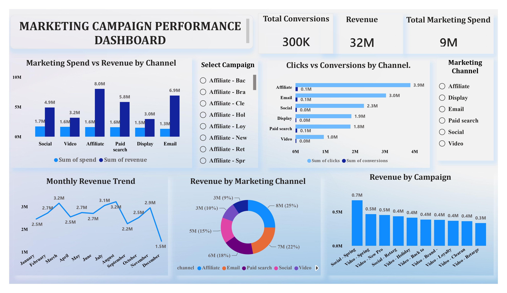

# NEXLEVR – Marketing Campaign Performance Dashboard

## Project Overview
This project uses Power BI to analyze marketing campaign performance and present key business metrics through an interactive dashboard.

## Tools Used
- Power BI Desktop
- Power Query
- DAX

## Dataset
- Source: DataBrighten Marketing Campaign Dataset
- Records: 1,000
- Format: Excel
- Data: Synthetic marketing campaign data

## Dashboard Features
- Total Revenue
- Total Marketing Spend
- Total Conversions
- Revenue by Campaign
- Revenue by Marketing Channel
- Clicks vs Conversions by Channel
- Monthly Revenue Trend
- Marketing Spend vs Revenue by Channel
- Interactive Channel and Campaign Name filters

## Data Preparation
- Checked column quality
- Checked duplicate campaign IDs
- Verified column names and data types
- Applied changes using Power Query

## Project Files
- Power BI dashboard (.pbix)
- Dashboard screenshot (.png)

## Objective
To understand campaign performance, compare marketing channels, and analyze revenue, spending, and conversions.

## Dashboard Preview

**Note:** This project uses synthetic practice data, not real company campaign data.
